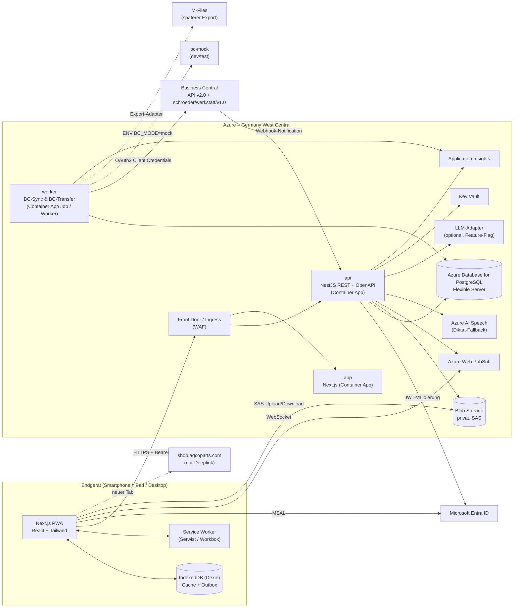
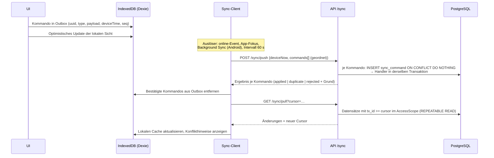
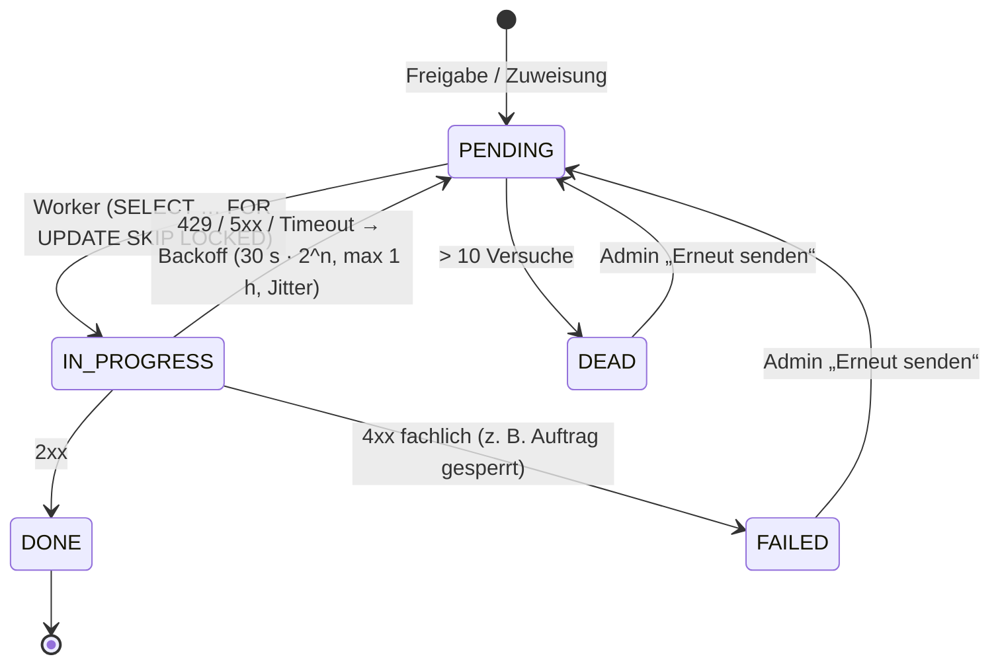

# Architektur – Schröder Monteur-App

Stand: Phase 0 (Analyse & Plan) · 19.11.2026
Verwandte Dokumente: [ENTSCHEIDUNGEN.md](./ENTSCHEIDUNGEN.md) · [OFFENE-PUNKTE.md](./OFFENE-PUNKTE.md) · Auftrag: [../PROMPT.md](../PROMPT.md)

---

## 1. Überblick

Die Monteur-App ist eine **Offline-first-PWA** für Monteure, Meister, Personal und Admins der deutschen Schröder-Standorte. Business Central (BC) bleibt führend für Serviceaufträge, Artikel, Bestände und Buchungen. Die App hält eine eigene PostgreSQL-Datenbank für alles, was in BC nicht oder nicht in dieser Form existiert (Stempelereignisse, Freigaben, Fotos, Chat, Feinstatus, Audit), und spiegelt die BC-Stammdaten, die sie offline braucht.



### 1.1 Komponenten

| Komponente       | Ordner                                   | Aufgabe                                                                                                                                                                                                   |
| ---------------- | ---------------------------------------- | --------------------------------------------------------------------------------------------------------------------------------------------------------------------------------------------------------- |
| **app**          | `/app`                                   | Next.js (App Router) PWA. UI, Offline-Cache, Outbox, Sync-Client, MSAL-Login. Keine Geschäftslogik, die sicherheitsrelevant ist – alles wird serverseitig erneut geprüft.                                 |
| **api**          | `/api`                                   | NestJS. REST + OpenAPI. Auth (Entra-JWT), Rollen- und Standortprüfung auf jedem Endpunkt, Sync-Endpunkte (Push von Kommandos, Pull von Deltas), Freigaben, Audit, Upload-SAS, Web-PubSub-Token.           |
| **worker**       | `/api` (eigener Entry-Point `worker.ts`) | Läuft als separater Prozess: BC-Delta-Sync (Lesen), BC-Transfer-Queue (Schreiben mit Idempotenz, Retry, Dead-Letter), Erinnerungen (vergessene Ausstempelung), Lösch-/Archivjobs, Mindestbestandsprüfung. |
| **shared**       | `/packages/shared`                       | Domänenlogik ohne I/O, im Browser **und** im Server genutzt: Zeitberechnung, ArbZG-Prüfungen, Rundung, Statusautomat, Produktivitäts-Engine, Zod-Schemas der Kommandos und DTOs.                          |
| **bc-contract**  | `/packages/bc-contract`                  | Zod-Schemas und TypeScript-Typen aller BC-Endpunkte (Standard v2.0 + eigene API-Pages). Gemeinsame Quelle für BC-Connector **und** BC-Mock → Contract-Tests.                                              |
| **ui**           | `/packages/ui`                           | Designsystem: Tailwind-Preset mit CI-Tokens, Basiskomponenten (Button, Tile, StampBar, SyncBadge …). Später vom CRM nachnutzbar.                                                                          |
| **bc-mock**      | `/bc-mock`                               | Fastify-Server mit denselben Pfaden wie BC (OData-Teilmenge: `$filter`, `$top`, `$skip`, `$expand`, `@odata.etag`, `If-Match`), Seed mit Landtechnik-Testdaten, Webhook-Simulation.                       |
| **bc-extension** | `/bc-extension`                          | AL-Extension: API-Pages `schroeder/werkstatt/v1.0`, Tabellenerweiterungen (Idempotenz-Feld), Löschprotokoll, Permission Set, Installationsdoku.                                                           |
| **infra**        | `/infra`                                 | Bicep-Module je Ressource, Parameterdateien dev/test/prod.                                                                                                                                                |

### 1.2 Anbindung an das neue CRM (Modulfähigkeit)

- **Gleicher Login:** Entra ID, eigene App Registration „Monteur-App API“ mit App Roles. Das CRM kann später dieselben Rollen nutzen oder die Monteur-App-API per On-Behalf-Of aufrufen.
- **Gemeinsamer BC-Connector:** `packages/bc-contract` + `api/src/bc/` sind als eigenständiges Paket `@schroeder/bc-connector` geschnitten (Token-Handling, Paging, ETag, Retry, Rate-Limit). Das CRM kann es direkt einbinden.
- **Gemeinsames Designsystem:** `packages/ui` als eigenes Paket `@schroeder/ui`.
- **Einhängen als Modul:** Die App läuft unter einem konfigurierbaren `basePath` (z. B. `/werkstatt`). Navigation, Header und Auth-Provider sind austauschbar (Shell-Slot), sodass das CRM die Monteur-App als Route-Gruppe oder per Module Federation aufnehmen kann.

---

## 2. Rollen, Standorte, Rechte

### 2.1 Rollen (Entra App Roles)

| App Role | Wert                 | Bemerkung                                                                                                     |
| -------- | -------------------- | ------------------------------------------------------------------------------------------------------------- |
| Monteur  | `Werkstatt.Monteur`  | Auch Azubis; Kennzeichen `isApprentice` am Benutzer (für Auswertungen, nicht für Rechte).                     |
| Meister  | `Werkstatt.Meister`  | Werkstattmeister und Werkstattleiter.                                                                         |
| Lager    | `Werkstatt.Lager`    | Teiledienst. Ergänzt (siehe ENTSCHEIDUNGEN E-12): empfängt Bestellanforderungen und Mindestbestandswarnungen. |
| Personal | `Werkstatt.Personal` | Standortübergreifend Abwesenheiten, Lesezugriff Anwesenheit.                                                  |
| Admin    | `Werkstatt.Admin`    | Stammdaten der App. Sieht **keine** Produktivität einzelner Monteure, sofern nicht zusätzlich Meister.        |

Die **Standortzuordnung** kommt nicht aus Entra, sondern aus der App-Datenbank (`user_location`), gepflegt durch Admins. Ein Meister kann mehreren Standorten zugeordnet sein.

### 2.2 Durchsetzung (Defense in Depth)

1. **NestJS-Guard** prüft Rolle + Feature-Flag pro Endpunkt (`@Roles()`, `@Feature()`).
2. **Scope-Service** baut für jede Anfrage einen `AccessScope { userId, roles, locationIds, resourceId }`. Jede Repository-Methode verlangt diesen Scope als Pflichtparameter – es gibt keine ungefilterte Abfragemethode im Service-Layer.
3. **PostgreSQL Row-Level Security** als zweite Linie: Die API setzt je Transaktion `SET LOCAL app.user_id`, `app.roles`, `app.location_ids`. RLS-Policies auf allen personenbezogenen Tabellen (`time_entry`, `stamp_event`, `absence`, `chat_message`, `productivity_snapshot` …).
4. **API-Tests** (`api/test/security/*.e2e-spec.ts`): Für jeden Endpunkt eine Matrix „Rolle × fremder Datensatz → 403/404“. Der Test enumeriert automatisch alle Routen aus dem OpenAPI-Dokument, damit kein neuer Endpunkt ungetestet bleibt.

Fremde Datensätze liefern **404** (nicht 403), damit IDs nicht ausgespäht werden können.

### 2.3 Feature-Flags (BetrVG § 87 Abs. 1 Nr. 6)

Flags je Modul **und** je Standort (Betriebsratszustimmung kann betriebsweise erfolgen). Durchsetzung serverseitig; das Frontend blendet nur aus.

| Flag                                                                                                                            | Modul                                                    |
| ------------------------------------------------------------------------------------------------------------------------------- | -------------------------------------------------------- |
| `stamping`                                                                                                                      | Stempelung (Anwesenheit + Auftrag)                       |
| `productivity.self`                                                                                                             | Produktivität – eigene Sicht Monteur                     |
| `productivity.team`                                                                                                             | Produktivität – Meister-Teamansicht                      |
| `team.overview`                                                                                                                 | Meister-Teamansicht (Anwesenheit, laufende Stempelungen) |
| `materials`, `consumables`, `photos`, `chat`, `dictation`, `dictation.ai`, `absence.sick`, `absence.vacation`, `planning.board` | übrige Module                                            |

---

## 3. Datenmodell

Konventionen: Primärschlüssel `uuid` (clientseitig erzeugbar → offline-fähig), `created_at`/`updated_at` (Serverzeit, UTC), `tx_id xid8` (schreibende Transaktion, Delta-Pull-Cursor, E-33) und `row_version bigint` (Reihenfolge), Soft-Delete `deleted_at` wo Pull-Clients Löschungen erfahren müssen. BC-Spiegeltabellen tragen `bc_system_id`, `bc_etag`, `bc_modified_at`.

### 3.1 ER-Diagramm

```mermaid
erDiagram
  LOCATION ||--o{ USER_LOCATION : "hat"
  APP_USER ||--o{ USER_LOCATION : "arbeitet an"
  APP_USER ||--o| BC_RESOURCE_MAPPING : "ist"
  LOCATION ||--o{ STORAGE_LOCATION : "hat Lagerorte"
  LOCATION ||--o{ SERVICE_ORDER : "Zuständigkeit"
  LOCATION ||--o{ CONTAINER : "Gebinde/Tank"
  LOCATION ||--o{ FEATURE_FLAG : "aktiviert"

  CUSTOMER ||--o{ SERVICE_ORDER : "beauftragt"
  SERVICE_ORDER ||--o{ SERVICE_ORDER_ITEM : "enthält"
  MACHINE ||--o{ SERVICE_ORDER_ITEM : "betrifft"
  ORDER_TYPE ||--o{ SERVICE_ORDER : "Auftragsart"
  ORDER_TYPE }o--|| PRODUCTIVITY_CATEGORY : "gemappt auf"

  SERVICE_ORDER ||--o{ ASSIGNMENT : "geplant"
  APP_USER ||--o{ ASSIGNMENT : "zugewiesen"
  SERVICE_ORDER ||--o{ ORDER_STATUS_EVENT : "Historie"

  APP_USER ||--o{ STAMP_EVENT : "stempelt"
  STAMP_EVENT }o--o| SERVICE_ORDER : "auf Auftrag"
  APP_USER ||--o{ TIME_ENTRY : "Zeitsegmente"
  TIME_ENTRY }o--o| SERVICE_ORDER : "auf Auftrag"
  TIME_ENTRY }o--o| OVERHEAD_TYPE : "Gemeinkosten"
  TIME_ENTRY ||--o{ TIME_ENTRY_REVISION : "Korrekturen"

  SERVICE_ORDER ||--o{ CONSUMPTION : "Material"
  ITEM ||--o{ CONSUMPTION : "Artikel"
  CONTAINER }o--o{ CONSUMPTION : "aus Gebinde"
  ITEM ||--o{ ITEM_STOCK : "Bestand je Lagerort"
  STORAGE_LOCATION ||--o{ ITEM_STOCK : ""
  SERVICE_ORDER ||--o{ PART_REQUEST : "Bestellanforderung"

  SERVICE_ORDER ||--o| WORK_REPORT : "Arbeitsbericht"
  TEXT_TEMPLATE }o--o{ WORK_REPORT : "Bausteine"
  SERVICE_ORDER ||--o{ PHOTO : "Fotos"
  SERVICE_ORDER ||--o{ CHAT_MESSAGE : "Thread"
  CHAT_MESSAGE ||--o{ CHAT_READ : "gelesen von"
  CHAT_MESSAGE }o--o| PHOTO : "Anhang"

  APP_USER ||--o{ ABSENCE : "Abwesenheit"
  APP_USER ||--o{ VACATION_BALANCE : "Resturlaub"

  APPROVAL }o--|| APP_USER : "freigegeben von"
  TIME_ENTRY }o--o| APPROVAL : ""
  CONSUMPTION }o--o| APPROVAL : ""
  ABSENCE }o--o| APPROVAL : ""
  WORK_REPORT }o--o| APPROVAL : ""

  APPROVAL ||--o{ BC_TRANSFER : "erzeugt"
  ASSIGNMENT ||--o{ BC_TRANSFER : "erzeugt"
  APP_USER ||--o{ SYNC_COMMAND : "sendet"
  APP_USER ||--o{ AUDIT_LOG : "handelt"
  APP_USER ||--o{ PUSH_SUBSCRIPTION : "Geräte"

  LOCATION {
    uuid id PK
    string code "z. B. WILD"
    string name "Wildeshausen"
    string bundesland "für Feiertage, z. B. NI"
    uuid bc_company_id
    string bc_responsibility_center
    string default_location_code
    string timezone "Europe/Berlin"
  }
  APP_USER {
    uuid id PK
    string entra_oid UK
    string display_name
    string email
    bool is_apprentice
    bool active
  }
  USER_LOCATION {
    uuid user_id FK
    uuid location_id FK
    string role "Monteur|Meister|Lager"
    uuid service_van_storage_id "Servicewagen-Lagerort"
  }
  BC_RESOURCE_MAPPING {
    uuid user_id FK
    string bc_resource_no
    string bc_employee_no
    uuid bc_company_id
  }
  SERVICE_ORDER {
    uuid id PK
    string bc_no "SA-…"
    uuid location_id FK
    string order_type_code
    string bc_status "Pending|In Process|Finished|On Hold"
    string app_status "Feinstatus"
    string priority
    string customer_no
    string address_json
    string contact_name
    string contact_phone
    text fault_description
    bool rework_flag "Nacharbeit"
    bigint row_version
  }
  MACHINE {
    uuid id PK
    string bc_service_item_no
    string brand
    string model
    string serial_no
    numeric operating_hours
    string machine_group
  }
  ASSIGNMENT {
    uuid id PK
    uuid order_id FK
    uuid user_id FK
    timestamptz planned_start
    timestamptz planned_end
    string conflict_state "ok|double|absence|replan"
    string bc_allocation_id
  }
  STAMP_EVENT {
    uuid id PK "Client-UUID"
    uuid user_id FK
    string kind "CLOCK_IN|CLOCK_OUT|JOB_START|JOB_PAUSE|JOB_STOP|OVERHEAD_START"
    uuid order_id FK
    string activity "WORK|TRAVEL|DIAGNOSIS"
    string overhead_code
    timestamptz device_time
    timestamptz received_at
    int clock_skew_ms
    bool skew_flag
  }
  TIME_ENTRY {
    uuid id PK
    uuid user_id FK
    string kind "ATTENDANCE|ORDER|OVERHEAD|BREAK"
    uuid order_id FK
    string activity
    timestamptz start_at
    timestamptz end_at
    int actual_minutes
    int billable_minutes "gerundet"
    string state "OPEN|SUBMITTED|APPROVED|TRANSFERRED|REJECTED"
    bool needs_correction
  }
  TIME_ENTRY_REVISION {
    uuid id PK
    uuid time_entry_id FK
    jsonb old_value
    jsonb new_value
    text reason "Pflicht"
    uuid changed_by FK
  }
  CONSUMPTION {
    uuid id PK
    uuid order_id FK
    string item_no
    numeric quantity
    string unit "STK|L|KG"
    string storage_code "Lager/Servicewagen/Tank"
    uuid container_id FK
    string cost_center "nur intern"
    numeric meter_before
    numeric meter_after
    string state
    numeric bc_posted_qty
  }
  CONTAINER {
    uuid id PK
    uuid location_id FK
    string kind "FASS|IBC|TANK|KANISTER"
    string item_no
    string storage_code
    numeric capacity_l
    numeric min_stock_l
  }
  PART_REQUEST {
    uuid id PK
    uuid order_id FK
    string item_no "oder Freitext bei neuem Artikel"
    bool is_new_item
    numeric quantity
    string source_location_code
    date expected_delivery
    string state
  }
  WORK_REPORT {
    uuid id PK
    uuid order_id FK
    text body
    jsonb required_fields
    bool complete
    timestamptz completed_at
    string state
  }
  PHOTO {
    uuid id PK
    uuid order_id FK
    string category "VORHER|NACHHER|TYPENSCHILD|BSZ|TEIL"
    string blob_path
    timestamptz captured_at
    string upload_state
  }
  CHAT_MESSAGE {
    uuid id PK "Client-UUID"
    uuid order_id FK
    uuid author_id FK
    bigint server_seq
    int client_seq
    timestamptz client_created_at
    text body
    bool is_system
  }
  ABSENCE {
    uuid id PK
    uuid user_id FK
    string type "KRANK|URLAUB"
    date from_date
    date to_date
    string half_day "NONE|AM|PM"
    string state "REQUESTED|APPROVED|REJECTED|CANCEL_REQUESTED|CANCELLED|REPORTED"
    text comment
    text rejection_reason
  }
  APPROVAL {
    uuid id PK
    string subject_type
    uuid subject_id
    uuid approved_by FK
    timestamptz approved_at
    string decision
  }
  BC_TRANSFER {
    uuid id PK "= Idempotency-Key"
    string target "SERVICE_LINE_RESOURCE|SERVICE_LINE_ITEM|ALLOCATION|COMMENT|ABSENCE|ITEM_JOURNAL|STATUS"
    jsonb payload
    string state "PENDING|IN_PROGRESS|DONE|FAILED|DEAD"
    int attempts
    timestamptz next_attempt_at
    text last_error
    string bc_record_id
  }
  SYNC_COMMAND {
    uuid id PK "Client-Kommando-UUID"
    uuid user_id FK
    string type
    timestamptz device_time
    timestamptz received_at
    string result
  }
  AUDIT_LOG {
    bigint id PK
    uuid actor_id FK
    string action
    string entity
    uuid entity_id
    jsonb old_value
    jsonb new_value
    text reason
    timestamptz at
  }
```



Weitere, im Diagramm vereinfachte Tabellen: `customer`, `item`, `item_stock`, `storage_location`, `order_type`, `productivity_category`, `order_type_mapping` (versioniert mit `valid_from`), `overhead_type`, `text_template`, `chat_read`, `vacation_balance`, `push_subscription`, `notification`, `feature_flag`, `setting` (Rundung, Erinnerungszeit, Löschfristen, Zielkorridor), `productivity_snapshot`, `bc_sync_cursor`, `bc_deleted_record`.

### 3.2 Zeitmodell

- **Stempelereignisse sind unveränderlich** (append-only). Aus ihnen werden `time_entry`-Segmente deterministisch abgeleitet (Funktion in `packages/shared`, identisch im Browser und auf dem Server). Damit zeigt das Gerät offline dieselben Zeiten, die der Server nach dem Sync berechnet.
- **Invariante:** Pro Monteur höchstens ein offenes Auftrags-/Gemeinkostensegment. `JOB_START` auf Auftrag B beendet das laufende Segment von Auftrag A implizit (direkter Wechsel).
- `JOB_START` ohne vorheriges `CLOCK_IN` erzeugt clientseitig ein implizites `CLOCK_IN` mit derselben Zeit (Hinweis in der UI).
- **Korrekturen** ändern nie Ereignisse, sondern erzeugen eine `time_entry_revision` (alt → neu, Begründung, Akteur) und einen `audit_log`-Eintrag.
- **Ist-Minuten** werden immer gespeichert. **Rundung** (Standard 15 min) wird erst bei Einreichung angewandt – konfigurierbar pro Standort: Rundungsbasis (Segment vs. Tagessumme je Auftrag + Tätigkeit), Modus (kaufmännisch / auf / ab), Raster.
- **ArbZG-Prüfung** (nur Warnung): Pausen 30 min ab > 6 h und 45 min ab > 9 h Arbeitszeit, Pausen zählen nur in Blöcken ≥ 15 min (§ 4 ArbZG); Ruhezeit < 11 h; Tagesarbeitszeit > 10 h. Ergebnis als `warnings[]` am Tag, sichtbar für Monteur und Meister.
- **Vergessene Ausstempelung:** Worker prüft zur konfigurierten Uhrzeit offene Anwesenheiten → Web Push. Am Folgetag wird der Vortag als `needs_correction` markiert; der Monteur muss eine Endzeit vorschlagen, der Meister gibt frei.
- **Geräteuhr:** Bei jedem Sync sendet der Client `deviceNow`. Der Server berechnet `skew = serverNow − deviceNow`. Abweichung > 2 min (konfigurierbar) → alle Ereignisse seit dem letzten erfolgreichen Sync werden mit `skew_flag` markiert und in der Freigabe-Inbox hervorgehoben. Gespeichert werden immer `device_time` **und** `received_at`.
- **Feiertage:** pro Bundesland des Standorts (Bibliothek `date-holidays`, plus Admin-Pflege für regionale Sonderfälle).

### 3.3 Statusautomat

| App-Feinstatus            | BC-Status                | Auslöser                                           | Nach BC schreiben (Default)       |
| ------------------------- | ------------------------ | -------------------------------------------------- | --------------------------------- |
| Neu                       | Offen (Pending)          | Import aus BC                                      | –                                 |
| Eingeplant                | Offen                    | Zuweisung auf Plantafel                            | nein (Zuordnung wird geschrieben) |
| Unterwegs                 | In Bearbeitung           | manuell / Start Fahrzeit                           | nein                              |
| In Arbeit                 | In Bearbeitung           | automatisch bei `JOB_START` (Arbeitszeit/Diagnose) | nein                              |
| Wartet auf Teile          | Zurückgestellt (On Hold) | Bestätigung Bestellanforderung                     | nein                              |
| Wartet auf Kunde/Freigabe | Zurückgestellt           | manuell                                            | nein                              |
| Fertig – Doku offen       | In Bearbeitung           | manuell, Pflichtfelder fehlen                      | nein                              |
| Fertig                    | Erledigt (Finished)      | manuell, Doku vollständig                          | nein                              |
| Freigegeben (Meister)     | Erledigt                 | Meister-Freigabe                                   | **ja** (Status Finished)          |
| Abgerechnet (aus BC)      | –                        | Gebuchte Servicerechnung mit `Order No.` erkannt   | – (nur lesen)                     |

Die Spalte „Nach BC schreiben“ ist pro Feinstatus konfigurierbar. Default: Die App schreibt den BC-Status nur bei Meister-Freigabe, damit der Grundsatz „Schreiben nur nach Freigabe“ gilt. Jeder Wechsel erzeugt einen `order_status_event` und eine Chat-Systemnachricht.

### 3.4 Produktivitäts-Engine

Reine Funktion in `packages/shared/productivity`:

```
calculate(entries: ApprovedTimeEntry[], absences, holidays, mapping: OrderTypeMapping@date, config) → ProductivityResult
```

- **Anwesenheitsstunden** = gestempelte Anwesenheit − Pausen − Gemeinkostenzeiten der Arten „Schulung“ und „Sonderaufgabe (angeordnet)“. Urlaub, Krankheit und Feiertage sind keine gestempelte Anwesenheit und werden daher ohnehin nicht gezählt; sie werden zur Transparenz separat ausgewiesen.
- **Verrechnete Stunden** = gerundete (`billable_minutes`), **freigegebene** Auftragszeiten, gruppiert nach Kategorie über das Auftragsart-Mapping, das zum Zeitpunkt der Leistung gültig war (`valid_from`). Nacharbeit-Kennzeichen übersteuert die Kategorie → nicht produktiv.
- **Altdaten-Regel** (optional je Auswertung): Auftragsart `KUNDE` mit „Wartung“ in der Beschreibung → Kategorie „Wartung Kunde“.
- **Ausgabe:** Stunden je Kategorie, Produktivität gesamt, Produktivität extern, Fahrzeitanteil, Dokumentationsquote, Zielkorridor-Bewertung. Monatsweise als `productivity_snapshot` persistiert (nachvollziehbare Basis für das spätere Bonussystem, inkl. Mapping-Version und Konfigurations-Hash).
- **Referenzfälle** als Unit-Tests (Tabellen in `packages/shared/productivity/__fixtures__`).

---

## 4. Sync-Konzept (Offline-first)

### 4.1 Grundprinzip



- **Kommandos statt Zustandsabgleich:** Der Client sendet fachliche Kommandos (`StampJobStart`, `ConsumeItem`, `SendChatMessage`, `ReportSick` …), jeweils mit Client-UUID. Der Server verarbeitet sie **idempotent** (`sync_command.id` ist Primärschlüssel) und **in Client-Reihenfolge** (`seq` je Gerät). Doppelt gesendete Kommandos (z. B. nach Verbindungsabbruch) liefern `duplicate` und ändern nichts.
- **Pull per Cursor:** Jede Zeile speichert die ID der schreibenden Transaktion (`tx_id`). Ein Pull liefert alle Zeilen mit `tx_id >= cursor` und gibt `pg_snapshot_xmin(pg_current_snapshot())` als neuen Cursor zurück. Transaktionen, die beim Pull noch liefen, kommen dadurch sicher beim nächsten Pull mit – nichts wird übersprungen (E-33). Der Server filtert über den AccessScope und RLS; der Monteur bekommt nur eigene Daten.
- **Fotos** laufen getrennt vom Kommandokanal: Das `AttachPhoto`-Kommando trägt nur Metadaten; die Binärdaten gehen per **Blob-Block-Upload** (Put Block à 1 MB + Put Block List) mit kurzlebigem SAS. Fortsetzung nach Abbruch: Client fragt bereits angenommene Blöcke ab (`Get Block List`) und lädt nur die fehlenden nach.

### 4.2 Vorab-Cache

| Daten                                                                         | Umfang                                    | Aktualisierung            |
| ----------------------------------------------------------------------------- | ----------------------------------------- | ------------------------- |
| Eigene Zuweisungen inkl. Auftrag, Kunde, Maschine, Kontakt                    | nächste 7 Tage + offene ältere            | Pull                      |
| Artikelstamm kompakt (Nr., Bezeichnung, EAN, Einheit, Bestand)                | Standort-Lagerorte + eigener Servicewagen | Pull, nachts komplett     |
| Verbrauchsstoffe, Gebinde, Tanks                                              | eigener Standort                          | Pull                      |
| Textbausteine, Auftragsarten, Gemeinkostenarten, Einstellungen, Feature-Flags | eigener Standort                          | Pull                      |
| App-Shell, Icons, Fonts                                                       | –                                         | Service Worker (Precache) |

Artikel **außerhalb** des Caches (andere Läger) sind nur online suchbar; die UI zeigt das an.

### 4.3 Konfliktregeln

| Fall                                                                      | Regel                                                                                                                                                                                                                                                                                                                                                   |
| ------------------------------------------------------------------------- | ------------------------------------------------------------------------------------------------------------------------------------------------------------------------------------------------------------------------------------------------------------------------------------------------------------------------------------------------------- |
| Stempelzeit vs. Statusänderung durch Dritte                               | Stempelereignisse gewinnen. Ein später eingehendes `JOB_START` setzt den Feinstatus auf „In Arbeit“, auch wenn der Meister zwischenzeitlich einen anderen Status gesetzt hat; der Meister erhält einen Hinweis. Ausnahme: Status „Freigegeben“/„Abgerechnet“ – dann wird die Zeit angenommen, aber als „nach Freigabe eingegangen“ in die Inbox gelegt. |
| Zuweisung während Offline-Phase geändert                                  | Kommandos zu nicht mehr zugewiesenen Aufträgen werden **angenommen** (Arbeit ist real passiert) und markiert. Der Monteur sieht nach dem Sync ein Banner „Deine Planung wurde geändert“ mit Diff.                                                                                                                                                       |
| Bestand                                                                   | Lokale Abbuchung sofort. Server prüft gegen verfügbaren Bestand; Unterdeckung wird **nicht abgelehnt**, sondern als Bestandskonflikt an Meister/Lager gemeldet.                                                                                                                                                                                         |
| Chat                                                                      | Keine Konflikte; Reihenfolge per `server_seq`, Nachrichten eines Autors behalten ihre `client_seq`-Reihenfolge, Anzeige mit „offline geschrieben um …“.                                                                                                                                                                                                 |
| Gleichzeitige Bearbeitung Arbeitsbericht (zwei Geräte desselben Monteurs) | Feldweise Last-Writer-Wins nach `device_time`, verlorene Version als Revision gespeichert.                                                                                                                                                                                                                                                              |
| Abgelehnte Kommandos (z. B. Rechte entzogen)                              | Bleiben im Client als „fehlgeschlagen“ sichtbar, mit Grund; nie stilles Verwerfen.                                                                                                                                                                                                                                                                      |

### 4.4 Plattform-Grenzen (bewusst eingeplant)

- **iOS/iPadOS:** keine Background Sync API → Sync bei App-Fokus, `online`-Event und Intervall. Web Push nur für **installierte** PWA (ab iOS 16.4). `navigator.storage.persist()` wird angefordert.
- **Barcode:** `BarcodeDetector` fehlt in Safari → `zxing-wasm` als einheitlicher Decoder.
- **Diktat:** Web Speech API nicht überall verfügbar → Azure AI Speech (Germany West Central) als Fallback.
- **Login offline:** MSAL-SPA-Refresh-Tokens laufen nach spätestens 24 h ab. Offline-Arbeit ist davon unabhängig (Outbox bleibt erhalten); beim nächsten Online-Gang ist ggf. eine erneute Anmeldung nötig, danach synchronisiert die Outbox. Die Outbox ist an die Entra-`oid` gebunden; ein anderer Benutzer am Gerät kann sie nicht absenden.

---

## 5. BC-Integration

### 5.1 Lesen – Quellen

| Entität                                            | Quelle        | Endpunkt                  | BC-Tabelle                                                           |
| -------------------------------------------------- | ------------- | ------------------------- | -------------------------------------------------------------------- |
| Mandanten                                          | Standard v2.0 | `companies`               | Company                                                              |
| Artikel                                            | Standard v2.0 | `items`                   | 27 Item                                                              |
| Lagerorte                                          | Standard v2.0 | `locations`               | 14 Location                                                          |
| Debitoren                                          | Standard v2.0 | `customers`               | 18 Customer                                                          |
| Mitarbeiter                                        | Standard v2.0 | `employees`               | 5200 Employee                                                        |
| **Bestand je Lagerort**                            | Extension     | `itemAvailabilities`      | 27 Item (FlowFilter Location) bzw. 32 Item Ledger Entry (aggregiert) |
| **Artikel-Barcodes / Referenzen**                  | Extension     | `itemReferences`          | 5777 Item Reference                                                  |
| **Serviceaufträge**                                | Extension     | `serviceOrders`           | 5900 Service Header (Document Type = Order)                          |
| **Serviceartikelzeilen**                           | Extension     | `serviceOrderItems`       | 5901 Service Item Line                                               |
| **Servicezeilen**                                  | Extension     | `serviceLines`            | 5902 Service Line                                                    |
| **Serviceartikel (Maschinen)**                     | Extension     | `serviceItems`            | 5940 Service Item                                                    |
| **Ressourcen**                                     | Extension     | `resources`               | 156 Resource                                                         |
| **Serviceauftragszuordnungen**                     | Extension     | `serviceOrderAllocations` | 5950 Service Order Allocation                                        |
| **Serviceauftragsarten**                           | Extension     | `serviceOrderTypes`       | 5903 Service Order Type                                              |
| **Zuständigkeitseinheiten**                        | Extension     | `responsibilityCenters`   | 5714 Responsibility Center                                           |
| **Abwesenheitsursachen**                           | Extension     | `causesOfAbsence`         | 5206 Cause of Absence                                                |
| **Gebuchte Servicerechnungen** (für „Abgerechnet“) | Extension     | `postedServiceInvoices`   | 5992 Service Invoice Header                                          |
| **Löschprotokoll**                                 | Extension     | `deletedRecords`          | eigene Tabelle (Subscriber auf OnAfterDelete)                        |

Hinweis: Die Standard-API v2.0 liefert keinen Bestand je Lagerort, daher die zusätzliche API-Page `itemAvailabilities`.

### 5.2 Schreiben – Ziele (nur nach Freigabe)

| App-Objekt                              | BC-Ziel (Default)                                                                                                 | Endpunkt (Extension)                   | Alternative (per Konfiguration)                                                           |
| --------------------------------------- | ----------------------------------------------------------------------------------------------------------------- | -------------------------------------- | ----------------------------------------------------------------------------------------- |
| Freigegebene Auftragszeit               | 5902 Service Line, Type = Resource, No. = Ressource, Work Type Code = Tätigkeitsart, Quantity = gerundete Stunden | `serviceLines` (POST)                  | 207 Res. Journal Line (Ressourcen Buch.-Blatt) bzw. Service-Buch.-Blatt                   |
| Gemeinkostenzeit                        | 207 Res. Journal Line (Buch.-Blatt-Vorlage konfigurierbar)                                                        | `resourceJournalLines`                 | –                                                                                         |
| Artikel/Verbrauchsstoff am Auftrag      | 5902 Service Line, Type = Item, Location Code, Quantity, Unit of Measure Code                                     | `serviceLines` (POST)                  | –                                                                                         |
| Diesel intern (Servicewagen, Vorführer) | 83 Item Journal Line (Artikel Buch.-Blatt, Abgang) mit Dimension Kostenstelle, **ungebucht**                      | `itemJournalLines`                     | –                                                                                         |
| Zuweisung                               | 5950 Service Order Allocation (Resource No., Allocation Date, Start/Finishing Time, Allocated Hours)              | `serviceOrderAllocations`              | Resource am Service Item Line                                                             |
| Arbeitsbericht                          | 5906 Service Comment Line (Type = Fault/Resolution/General), umbrochen auf 80 Zeichen                             | `serviceCommentLines`                  | Work Description (Blob am Service Header)                                                 |
| Status                                  | 5900 Service Header.Status                                                                                        | `serviceOrders` (PATCH mit `If-Match`) | –                                                                                         |
| Krankheit / Urlaub                      | 5207 Employee Absence (Cause of Absence `KRANK` / `URLAUB`, je Tag eine Zeile, Halbtag als Quantity 0,5)          | `employeeAbsences`                     | Adapter „Zeiterfassungsposten“ (OP-01), Time Sheet via Standard `timeRegistrationEntries` |
| Bestellanforderung                      | App-Datensatz + Benachrichtigung Lager                                                                            | –                                      | Adapter BC-Umlagerungsauftrag (5740 Transfer Header)                                      |

**Idempotenz:** Tabellenerweiterungen ergänzen an 5902, 5906, 5950, 5207, 207, 83 das Feld `Monteur App Id` (Guid, indiziert). Die API-Page prüft im `OnInsertRecord`, ob ein Datensatz mit dieser ID existiert, und liefert dann den vorhandenen zurück (HTTP 201 mit Bestandsdatensatz statt Duplikat). Damit ist jeder Retry gefahrlos.

**Kein Buchen:** Die Extension enthält bewusst keinen Codeunit-Aufruf für Lieferung/Rechnung oder Buch.-Blatt-Buchung.

### 5.3 BC-Transfer-Queue



- Abhängigkeiten werden eingehalten (Zuordnung vor Zeitzeile ist nicht nötig, aber z. B. Status „Finished“ erst nach allen Zeilen desselben Auftrags).
- BC-Limits: max. 5 parallele Anfragen je Benutzer/Mandant werden nicht überschritten (Worker-Concurrency je Mandant = 3), `$batch` für Zeilenpakete eines Auftrags.
- Admin-Ansicht „Fehlgeschlagene Übertragungen“: Filter nach Standort/Ziel/Fehler, Payload-Ansicht, erneut senden, als erledigt markieren (mit Begründung → Audit).

### 5.4 Delta-Sync (Lesen)

- Je Mandant und Entität ein Cursor (`bc_sync_cursor`): `$filter=lastModifiedDateTime gt {cursor - 5 s}` (Überlappung gegen Uhr-/Commit-Versatz, Dedupe über `bc_system_id` + `@odata.etag`).
- Intervall 3 min (konfigurierbar 2–5 min), On-Demand-Refresh für einen Auftrag (`POST /orders/{id}/refresh`) mit Rate-Limit.
- **Webhooks:** Subscriptions auf `serviceOrders`, `serviceLines`, `serviceOrderAllocations` (BC unterstützt Webhooks auch für API-Pages aus Extensions). BC bündelt Notifications (ca. 30 s) und Subscriptions laufen nach 3 Tagen ab → Worker erneuert täglich. Eine Notification löst nur einen gezielten Delta-Lauf aus; der Delta-Sync bleibt die verlässliche Quelle.
- **Löschungen:** BC-API liefert keine Löschungen im Delta → Löschprotokoll-Tabelle in der Extension (`deletedRecords`) + nächtlicher ID-Abgleich als Sicherheitsnetz.
- Vollständig abgerechnete Serviceaufträge verschwinden in BC aus Tabelle 5900; die App erkennt das über `postedServiceInvoices` (Feld `Order No.`) und setzt „Abgerechnet“.

### 5.5 Standortlogik

`location` ist die zentrale Klammer: BC-Mandant (`bc_company_id`), Zuständigkeitseinheit (Serviceaufträge → Standort), Standard-Lagerort, Lagerorte (inkl. Servicewagen-Lagerorte), Tankanlagen, Bundesland (Feiertage), Zeitzone. Alles Standortbezogene (Rechte, Flags, Rundung, Ziele, Erinnerungszeit) hängt an `location`. Die Annahme zur Mandantenstruktur steht in OFFENE-PUNKTE OP-07.

### 5.6 BC-Mock

- Implementiert dieselben Pfade wie `/api/v2.0/companies({id})/…` und `/api/schroeder/werkstatt/v1.0/companies({id})/…`, inkl. OData-Teilmenge, ETags, `$batch`, Fehlerformat von BC, 429-Simulation und Webhook-Aufrufe.
- Seed: 4 Standorte (Wildeshausen NI, Cloppenburg NI, Bremervörde NI, Alzey RP – Testdaten, keine echte Standortliste), je 4–8 Monteure, Maschinen von Fendt, Valtra, Massey Ferguson, Amazone, Lemken, Horsch, Merlo, CAT; Auftragsarten `KUNDE`, `KLEING`, `WARTUNG`, `INTWART`, `GARANTIE`, `KULANZ`, `GEBR`, `UEBERGABE`; Artikel inkl. Öle (Liter), Diesel, AdBlue, Fette, Filter, Verschleißteile mit EAN.
- Umschalten per `BC_MODE=mock|sandbox|production`.
- Contract-Tests: Connector-Tests laufen gegen den Mock, beide validieren gegen `packages/bc-contract`. Antworten aus der echten Sandbox werden später als Fixtures aufgezeichnet und gegen dieselben Schemas geprüft.

---

## 6. Weitere Querschnittsthemen

### 6.1 Echtzeit und Push

- **Azure Web PubSub:** Gruppen `order:{id}` (Chat, Status), `user:{id}` (Zuweisungen, Freigaben), `location:{id}:board` (Plantafel). Client-Token wird von der API mit genau den erlaubten Gruppen ausgestellt.
- **Web Push (VAPID):** Für Ereignisse bei geschlossener App (neue Zuweisung, Chat, Freigabe-Ergebnis, vergessene Ausstempelung, Krankmeldung an Meister/Personal). Push-Inhalte enthalten keine personenbezogenen Details außer dem Nötigsten („Neue Nachricht zu SA-24-0815“).

### 6.2 Dateien

- Blob-Container `photos` privat, Pfad `{locationId}/{orderId}/{photoId}.jpg`, SAS nur für genau einen Blob, 10 min, Schreib- oder Leserecht getrennt.
- Clientseitig: Skalierung auf max. 2.000 px Kante, JPEG-Neucodierung (entfernt alle EXIF-Daten inkl. GPS), Aufnahmezeit als Metadatum.
- `DocumentExportAdapter` (Interface) für den späteren M-Files-Export; V1-Implementierung `NoopExportAdapter`.

### 6.3 Diktat und KI-Umformulierung

- Primär Web Speech API (`de-DE`), Fallback Azure AI Speech über die API (Audio wird nicht gespeichert).
- KI-Umformulierung hinter Feature-Flag `dictation.ai` und als `TextRewriteAdapter` gekapselt; Modell/Anbieter je nach Datenresidenz-Freigabe (OP-10). Der Monteur sieht immer einen Vorher/Nachher-Vergleich und bestätigt.

### 6.4 AGCO-Teilekatalog

`PartsCatalogAdapter` mit Methoden `buildSearchUrl({partNo?, serialNo?})` und `resolve(partNo) → BcItem[]`. V1-Implementierung `AgcoDeeplinkAdapter` erzeugt ausschließlich URLs zum Öffnen in neuem Tab – kein Abruf, kein Parsing. Platz für `AgcoMdiAdapter` später.

### 6.5 Sicherheit und Betrieb

- Entra-JWT-Validierung (Issuer, Audience, Signatur, `tid`), App Roles aus Token, Standortrechte aus DB.
- BC-Zugriff ausschließlich vom Worker/API mit Client Credentials; Secret bzw. Zertifikat im Key Vault, Zugriff per Managed Identity.
- Application Insights mit Korrelation (`traceparent`) Client → API → BC.
- OWASP ASVS L2 als Checkliste in Phase 8; CSP, HSTS, keine Inline-Skripte.
- Umgebungen dev / test / prod, je eigene Ressourcengruppe; dev und test laufen gegen den BC-Mock bzw. die BC-Sandbox.

### 6.6 Monorepo-Struktur

```
/app                  Next.js PWA
/api                  NestJS API + Worker (src/main.ts, src/worker.ts)
/bc-mock              Fastify BC-Mock
/bc-extension         AL-Extension (app.json, src/, permissionset, README)
/infra                Bicep (main.bicep, modules/, params/*.bicepparam)
/packages/shared      Domänenlogik, Zod-Schemas
/packages/bc-contract BC-Schemas
/packages/ui          Designsystem
/docs                 Doku (Deutsch)
/.github/workflows    CI/CD
```

Werkzeuge: pnpm Workspaces + Turborepo, TypeScript strict, ESLint + Prettier, Vitest, Playwright, Drizzle ORM + drizzle-kit Migrationen.
